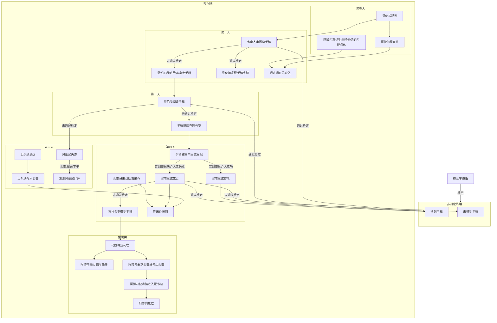
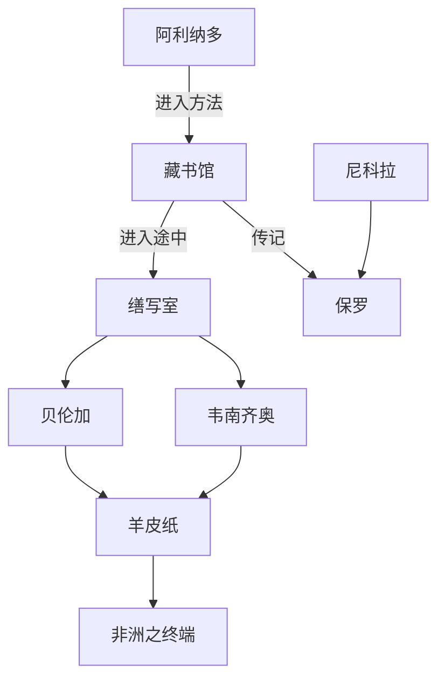

todo:

- 结局

- 另两份分支正文

- 保罗线索线

- 本诺线索线

- 埃玛洛线索线

- 启示录线索线

- 雷米乔线索线

- “敌基督”线索线

- 各处零碎线索

- 圣骨堂密道

- 实际的怪物

- 重写游戏数据

- 重写手稿线索线

- 减少原文引用性的 cg

- 额外设计藏书馆

- 名词考据

还有很多工作，还不能休息……

# 玫瑰的名字

## 前言

> *Stat rosa pristina nomine nomina nude tenemus*

> *昔日玫瑰以其名流芳，今人所持唯玫瑰之名*

> ——《鄙世论》，莫尔莱的贝尔纳

（=这里应当一人有一段自己的私货（）=）

> *其中的寓意在于：确实存在一些令人魂牵梦绕的观念，但他们从来都不是个人的观念，而是书与书之间的言说。此外，一场真正的侦探调查应该证明的是，凶手正是我们自己。*

> ——《玫瑰的名字注》，翁贝托·埃柯

## 信息

- 规则: coc7th

- 人数: 2-4 人

- 时间: （=???=）

1928 年 11 月底，寒冷的冬日，意大利北部山区，这座修道院屹立于此，将要度过它的第一个千年。

六年前，庇护十一世教宗当选，教会与墨索里尼当局形成了一种微妙的合作关系。不久后的 1929 年 2 月，随着《拉特兰条约》的签订，二者的合作将达高峰。

而在此之前，一场关于教会何去何从的辩论将在这座修道院中展开。是选择在法西斯的压力下维护自身的独立与尊严，抑或是伙同法西斯去征伐更遥远的敌人？

不过，一桩凶案将先一步降临这里，为修道院无上的荣光蒙上阴翳。

## 真相

五十年前，保罗从馆长一职就任了修道院院长，其助手豪尔赫利用自己的西班牙背景，在与除保罗外最年长的僧侣阿利纳多的竞争中胜出，坐上了藏书馆馆长的位置。十年后，豪尔赫由于疾病逐渐目盲，对他言听计从的助手罗伯特便担任了馆长一职。

二十年前，当时的院长保罗

在其他人看来，保罗也许是在旅途中遭遇了匪徒，由于当时的馆长罗伯特病魔缠身无法接任院长一职，豪尔赫放任毫无根基的阿博内坐上了院长的位置。随着对豪尔赫绝对忠诚的马拉希亚被任命任命为藏书馆馆长，豪尔赫彻底掌控了这座修道院。

七年前，马拉希亚任命与他有暧昧关系的贝伦加为藏书馆馆长助手贝伦加。豪尔赫自然不可能信任一个与自己毫无关系的年轻僧侣，同时，阿博内也在试图违背豪尔赫意志开放图书馆来攫取更大的声望。豪尔赫感到自己对于修道院的掌控正在减弱，在一个冬日指示马拉希亚偷取了塞韦里诺医务室中的一瓶毒药，后者得手后将破坏伪装成暴风雪所为。

这瓶毒药被豪尔赫刷在一份手稿上（详见[《诗学（第二卷）》手稿](#《诗学（第二卷）》手稿)）。

正如豪尔赫所料，由于虚荣心以及一些情感作祟，贝伦加向其他年轻僧侣泄漏了藏书馆的秘密。两天前，贝伦加用这些秘密向阿德尔摩换取了禁忌之事。一天后的晚上，内心煎熬的阿德尔摩选择向豪尔赫告解，因受到了后者严厉的训斥，他决心寻死。在墓地徘徊时恰好被贝伦加看见，前者着魔般地向贝伦加控诉后便向东北角走去，从马厩的围墙缺口跳下悬崖。后者则受到惊吓立刻逃回了宿舍。

在骤雪中，阿德尔摩尸体所在的悬崖发生了坍塌，在模组开始的当天早上，他的尸体被发现，由于雪水浸透和塌方，尸体受到了严重的破坏。

在调查员到达的下午，阿德尔摩已经被简单地埋葬在公墓中。

### 修道院

*“出于善意和仁慈，请容我隐去修道院的名字。”*

这是一座坐拥基督教世界最庞大藏书馆的修道院，藏书馆中不仅有神圣的知识，也有至深的禁忌。为了世人不被知识中的魔鬼所擒获，除了知晓其中一切秘密的藏书馆馆长与预备着因无法预料的意外而随时接替他的助手，藏书馆不对任何人开放，任何人想要借阅藏书馆的藏书都需要经过馆长的许可。一般而言，馆长也就会是之后的修道院院长。

在意大利十二月的冬日，教规所规定的僧侣活动的时间表大致如下：

- 早课：凌晨两点半至三点。

- 赞美经：清晨五点至六点，黎明时分结束。

- 晨祷：约七点半，破晓前。

- 辰时经：约九点。

- 午时经：中午。

- 午后经：下午两点至三点。

- 夕祷：将近四点半落日时分（按教义规定，在夜幕降临之前用晚餐）。

- 晚祷：约六点（七点之前僧侣就寝）。

调查员们可以自由参加上述环节。修道院内的僧侣会大致按照教规的规定而行动，出于各种原因的缺席一般无需说明。当然，若一名僧侣在各处都不见人影，院长会组织人在院墙内寻找他。

一般而言，当模组中提及早晨，指的是早课、赞美经、晨祷、辰时经；提及下午，指的是午后经、夕祷；提及深夜，指的是晚祷之后直到第二天的早课前。午时经与晚祷一般不单独作为一个给调查员自由探索的时间结点，而是灵活地与前后的时间段组为一个整体。

### 楼堡-藏书馆

藏书馆按照中世纪对于世界的理解建造，房间间以石拱门作为分割，每个房间均有一个石拱门的上分有金质浮雕字的《启示录》铭文，部分房间的铭文涂红漆。每个房间按照其铭文首字母，以红色铭文房间为开头的连续几个房间拼成地名。关于具体的铭文原句见 [附录二](#藏书馆中的启示录节选)。

书籍按照其作者的出身地放置于对应地名的房间中。地名大致按照地理位置排列，需注意该图中左上角的角楼是朝北的，按照地理位置看待时需顺时针旋转四十五度。

为了查清藏书馆以及非洲之终端的秘密，调查员们很可能多次进入藏书馆。在第一天晚上进入藏书馆会在缮写室遇到韦南齐奥、第二天会遇到贝伦加。

任何情况下，若他们进入藏书馆的时间不是马拉希亚锁门并离开楼堡之后，他们会被发现。第一次阿博内会给予警告，第二次被发现则会被阿博内送出修道院。

#### 暗道

入口在教堂的第三祈祷室（圣骨堂），按动机关打开祭坛可以进入，出口是楼堡的南角楼，通往缮写室的阶梯。

#### 第一次进入

若调查员们携带了任何可以在密室中帮他们辨别方向的工具，或是成功的导航检定，则他们可以在行进中认识到自己的大致方位并在脑海中绘出藏书馆的地图。

否则，他们在藏书馆中将难以辨别方向，他们每次行进都需要有至少一人通过困难的智力检定，否则他们必须立刻返回以避免在藏书馆中迷失。

藏书馆被分为七个部分。第一次进入，调查员若携带工具可以探索四个部分，否则由于辨认方位的开销，他们的时间只够进入三个部分。

马拉希亚在“AEGYPTUS”对应的“E”房间（进入第三部分）设置了迷香，调查员进入时需要通过一个代替嗅觉的聆听，成功可以使调查员意识到迷香的存在并更为警惕的进入房间。否则需要通过一个困难难度的体质，失败的调查员会昏睡过去，需要其他调查员帮助才能从房间中脱困。迷香会产生幻觉，受其影响的调查员 SC 0/1。

#### 第二次及以后

有了第一次的经验，调查员们能完整访问藏书馆中的任意房间。

成功的图书馆使用和教育会使调查员意识到藏书的具体房间与作者的出身地相关，之后调查员便可以使用图书馆使用查阅藏书馆中的书籍。

一般而言每晚的时间只够每人查阅一本书籍，第二次进入由于尚未理清地图，可能没有时间用于查阅书籍。

#### 非洲之终端

藏书馆的右下角空房间为“非洲之终端”密室，其左上角“S”房间有进入的镜门。镜子附有魔法，会使看到它的调查员看到自己扭曲而诡异镜像（SC 1/1d3），并产生逃离冲动。打开镜门的方法见 [“非洲之终端”羊皮纸](#“非洲之终端”羊皮纸)。

特殊的，豪尔赫并不从藏书馆镜门进入非洲之终端，圣骨堂密道的末端存在另一扇暗门可以进入南角楼的墙壁内夹层，直接通往非洲之终端。这条道路的末端仍设置有相似的机关。

该密室用于存放被认为是最危险的禁书，在藏书馆的目录中这些书统一在非洲的“非洲之终端”的标题下，任何时候馆长对外都会宣称这些书籍已经丢失。

查阅目录可以看到其进入的书籍年份跨度极大，下最近进入藏书馆的一部书中含有四篇文章：

> 一、阿拉伯语，《论一个傻子的言语》；

> 二、阿拉伯语，《埃及炼金术手册》；

> 三、拉丁文，亚尔科佛里巴导师对迦太基主教西普里安的《晚餐》的评价；

> 四、希腊语，《关于贞女的淫荡和娼妓的情爱之无头书》。

（=亟待嵌入性更好的大改，暂定第二部分含 coc 相关用于结局=）

该手稿在豪尔赫在任馆长时期进入藏书馆，豪尔赫在目录上刻意地隐藏了手稿事实真实的第三卷：希腊语，《诗学（第二卷）》。

无论调查员何时进入非洲之终端，豪尔赫都会在那里等待调查员。具体的内容参考所有正文最后一天的藏书馆一节。

#### 可以从藏书馆中查阅的资料

- 修道院的历史

-

-

### 《诗学（第二卷）》手稿

*模组中提及“手稿”时均指“《诗学（第二卷）》手稿”。*

这份由多部著作合订成的手稿内有失传已久的亚里士多德《诗学（第二卷）》最后的孤本。

手稿来自西班牙，豪尔赫从家乡得到了这份手稿。

对于豪尔赫而言，“哲人”亚里士多德的每一部书都颠覆了基督教几个世纪以来所积累的部分智慧、每一句话都颠覆了世界的形象，但就其他书籍还没有到颠覆上帝形象的地步，但《诗学（第二卷）》除外。他认为：“笑”使愚民摆脱对魔鬼的惧怕，“笑”能在瞬间消除愚民的恐惧心理，愚民受哲人的启发会认为“笑”是人类的终极；但因为治人的法规的基点是惧怕、对上帝的惧怕，愚民的“笑”将颠覆神圣的形象。因而他不能让这份手稿公之于众。

为了保护手稿，豪尔赫指示马拉希亚取得塞韦里诺保存的一瓶毒药，并将其涂抹在了《诗学》的部分上。

《诗学》的部分的亚麻纸受潮而粘合在一起故而难以阅读，短暂地碰触这些纸张不会致死，但只要尝试用手指分离纸张，就足以接触到致死量（手稿的其他部分没有毒性）。该手稿与其他修道院所严密保护的禁书一同在藏书馆密室“非洲之终端”中，这些书对外声明是已遗失的书籍。

可以用分离纸张的工具安全地阅读有毒部分，带手套可以避免接触有毒内容，但受手套限制调查员将无法阅读。

### “非洲之终端”羊皮纸

*模组中提及“羊皮纸”时均指“‘非洲之终端’羊皮纸”。*

韦南齐奥依照从贝伦加那听来的关于非洲之终端的秘密和手稿的部分内容，用黄道十二宫字母加密写成的文字。

形式如下：

解密后的全文：

> 秘密 终端 非洲 手 上方 偶像/幻象 在 第一 和 第七 之于 四

> Secretum finis Africae manus supra idolum age primum et septimum de quatuor

> 非洲之终端的秘密：用手在偶像的上方四的第一和第七操作

>

> 净化心灵的可怕的毒药……

> 击毁敌人的最好的武器……

> 起用最卑微、粗俗和丑陋的人，从他们的缺陷中得到了乐趣……他们不应该死……别在高贵和有权势的人的家里，到农民的村庄里去，酒足饭饱之后……粗短的身材，畸形的面孔。

> 他们强暴淑女，与娼妓同帧共勉，并不邪恶，毫不畏惧。

> 一种不一样的真实，一种不同的真实形象……

> 古老的无花果树。

> 厚实的石头在平原上滚动……在眼皮底下。

> 需要用欺骗的手段来欺骗他人并要出其不意，说出人们以为相反的事情，说的是一回事，却把它理解成另一回事。

> 知了从地上向他们鸣唱。

首句为拉丁文，实际含义是：按下在非洲之终端镜门上方镌刻的“Super thronos viginti quatuor”铭文“quatuor”一词的第一与第七个字母。

后面的段落为希腊语，是亚里士多德在《诗学（第一卷）》与《修辞学》中使用过的例句集合，成功的希腊语与教育检定可以使调查员想到这个出处。

由于韦南齐奥是希腊人，对于“idolum”一词，拉丁文较好的调查员可能会自动地将其翻译为“偶像”，而具有希腊背景的调查员则可能看出其“幻象”的他义，从而意识到其代指的是藏书馆内的镜子。

## 人物

### 保罗

意大利人。修道院的上一任院长，年纪轻轻便当上了藏书馆馆长。勤恳工作、嗜书如命，在馆长一职上为藏书馆充实了许多藏书。然而，他有个奇怪的缺陷，被称作“不会写字的院长”，其任职馆长期间的文书工作由其助手豪尔赫代劳。

借由一位不知名友人的推介，保罗在前往（待研究地图）处参加贱民聚居地（西西里的卡尔塔武图罗）圣塞巴斯蒂安节游行，这是一个纪念圣人的节日，对于保罗而言，圣塞巴斯蒂安受箭的圣迹自然熟读，但出于对这位友人的信赖，对于这次盛会他似乎具有非同一般的兴趣，在未对助手豪尔赫给出解释的情况下，二人从刚刚结束的巴勒莫民族博览会前往聚居地（西西里的卡尔塔武图罗），在途中他与豪尔赫百般叮嘱，准备完全。当然，保罗携带了那枚据称圣者的遗物：“巫术之卵”——这正是他前往该博览会的原因。

圣塞巴斯蒂安节中，除去各式豪尔赫也耳熟能详的典仪，保罗观察的重心放在贱民上，贱民与贱民的对话，牧羊人与羊群的交流。他事无巨细地询问，交流，最后是记录——自然，这由豪尔赫进行。最初豪尔赫感动于卡尔塔武图罗贱民们的虔诚，最后他惊讶于贱民们出奇地拥有知识。圣塞巴斯蒂安节中，保罗救助了一位濒死的孩童——濒死的原因是伤寒或者霍乱——他使用了一种豪尔赫感到陌生的异教手段，既非圣水祷告也非药草，豪尔赫对此行为产生疑虑。

雷米乔正是在这个时候第一次见到保罗的，

最后的事件：圣塞巴斯蒂安纪念游行

纪念游行是圣塞巴斯蒂安节最盛大的活动，

贱民舔地而行，直至舌头出血，血迹跟随圣像在巡中环绕教堂；间或可见的红绳红带替代了圣塞巴斯蒂安的一袭白衣。

贱民效仿圣徒流血，而这一次他们的知识并未带给他们救赎，保罗并不愿意救助为耶和华牺牲的

即使保罗已经部分掌握了藏书馆中的力量，他依旧想要为给予了他民俗知识的贱民解释不救助的原因，但贱民们出于愤怒已无心细听，于是保罗死于军警与贱民的武装冲突。

武装冲突爆发时，公地夺取正式开始，雷米乔却改扮了正常装束脱开

当保罗的头颅落下时，豪尔赫逃离他导师前的最后一眼，见到的正是贱民们面上的笑——那笑正像他千万次在敬爱的保罗面上曾见过的，分毫不差。

保罗死去的谶语：

“圣徒受箭，所以土地受犁。”

”圣徒流血复生，土地也是如此“

豪尔赫并没见到奶和蜜，他只见到了血与火。

而血气方刚的雷米乔，紧抓着保罗的厚望，在血与火的边缘落荒而去。

（可能的隐藏世界线）这恰恰正是保罗与西西里工人同盟中那位友人的默契，西西里工人同盟公地夺取的宗教合法性再没有比一位圣人的献身祭祀更能说明的了。

（更有可能的世界线）保罗并不在乎什么西西里工人同盟，他只是为耶和华献出了自己想要奉献的

（该事件只有豪尔赫知道内情），其院长职位由阿博内取代。

### 阿博内

意大利人。身体壮硕而矮小，胡子浓密，手指修长，眼睛中时常透出一种傲慢。

修道院院长，传说他年轻时照料过圣托马斯，托马斯死在修道院中，他设法把圣人的遗体沿着塔楼的阶梯运了下来。旁人通常认为：“许久以后，他果真因此当上了修道院的院长”。然而，其上位也有豪尔赫的操纵，豪尔赫认为他无法掌握修道院，但又有一些名目可以坐稳这个位置，便放任他上任。

他从豪尔赫那知晓了藏书馆的秘密，不过只是一知半解。

### 豪尔赫

西班牙人。年老而微微驼背的年长修士，面容和眼球泛白。声音威严，四肢有力。

年过八十，已经盲目二十余年，对藏书馆与修道院的一切了如指掌。盲目前的十年是藏书馆馆长，盲目后，通过扶持罗伯特、阿博内与马拉希亚的上位继续掌控着修道院。由于其绝对的声望，院内的众人并不像一般认为的那样向院长告解、而是向豪尔赫告解，这使他进一步能了解修道院正在发生的各种事情。

是前任院长保罗的弟子，受其影响饱读诗书，也因此在保罗死后思想逐渐极端，认为贱民必须保持对上帝的敬畏，不应向他们传授知识。藏书馆中《诗学（第二卷）》中哲人对于“笑”的描述使他心生恐惧，这份手稿对他而言是比“非洲之终端”中其他禁书更禁忌的存在。对他而言，如果说其他的禁书教给贱民僭越上帝、颠覆教权的方法与论述，那么“笑”则是他们这么做的诱因。

阅读过“非洲之终端”中藏书的历代藏书馆馆长（自然，其中大部分当上了院长）都清楚超自然力量的存在，对他们而言，这便是藏书馆所要封锁的、恶魔的力量（当然对于豪尔赫情况稍有不同）。然而，在诸如法国大革命等等修道院的危险时期，这些禁忌的力量也会成为保护修道院的神兵利器。豪尔赫也不例外，虽然他从未毁坏过任何书籍，但如果藏书馆不再能封锁它们，他不吝使用这些力量彻底毁掉整座藏书馆。

### 阿利纳多

意大利人。老态龙钟，时而风趣幽默。

1887 年，保罗升任院长，豪尔赫凭借其西班牙背景、以一份精美的《启示录》手稿出名而在竞争中胜出。

阿利纳多一直记恨在心，但无可奈何。随着年龄增大，他已不记得豪尔赫就是那个对手，他只记得马拉希亚被安排到馆长的位置是对手的手腕；那个对手壮年失明，“提前进入了黑暗的王国”；修道院落在了一个外国人手里。而豪尔赫则年轻记性好，是僧侣们了解藏书值得信赖的对象。

随着老僧侣们逐渐逝世，这段历史在院墙内除了当事人，只有 [尼科拉](#尼科拉) 还略知一二。

他说出的话有些半真半假，连他自己也不清楚自己所言的真伪，故而他也常常意识不到自己正在讨论一些不宜在修道院内讨论的话题。

### 马拉希亚

德意志人。脸色苍白，布满皱纹，眼神深邃而伤感，透露出一种女人味。脸上缺乏表情，似乎在背负某种令人不快的义务。

藏书馆馆长，由豪尔赫扶植上位。并不聪慧，像是一只看门狗一样为豪尔赫看管藏书馆，却不知道自己看管的究竟是什么。如果有人要借阅书籍，往往也是向豪尔赫询问这本书能否借阅，马拉希亚只是将书从藏书馆中拿出。

与贝伦加间有暧昧的情愫，然而贝伦加在这段感情中并不忠诚。

### 阿德尔摩

*“那个死去的年轻人身上有某种……女人味，那是恶魔般的东西。他的目光中有青春少女寻求与噩梦交流的眼神。”*

年纪尚轻的袖珍画名师。

尸体在调查员到达当日的早晨于楼堡东北角被发现，在调查员到达修道院之前已被埋在公墓中。

### 贝伦加

英国人。身材瘦削，面色苍白，眼神迷离，有一种独特的魅力。

藏书馆馆长助手，与马拉希亚有暧昧关系，也正因此被选中担任馆长助手。

他爱慕虚荣、渴望男色，利用藏书馆的秘密向他人交换不正当的关系。

### 塞韦里诺

意大利人。年龄稍大，头发凌乱，目光炯烁，透露出对于草药学的痴迷与对自己所知的自信。

草药师，负责修道院的医务室，有一个园圃用于培养各种花草。其中，一种特殊的可以致幻的药草每晚都会用于藏书馆的防卫。

由于修道院的盛名，塞韦里诺有幸能得到来自世界各地的花草与药石，其中不乏致命的毒药。塞韦里诺平时都带着一副皮手套，使他可以摆弄各种有毒药草。

### 韦南齐奥

希腊人。身材精干，充满干劲。

阿拉伯语与希腊语的翻译者，主要工作是图书绘制插图。亚里士多德的忠实信徒。

### 本诺

法国人。总是慌慌张张的，令人感到不可靠。

研读修辞学，了解阿拉伯语与希腊语。有着强烈的好奇心，但这种好奇心与知识和智慧无关，只是出于他的虚荣。

### 埃玛洛

意大利人。语言刻薄，脸上总带着一种冷笑，似乎永远不相信人们的愚昧昏聩。

认为修道院必须与罗马政府合作以争取世俗权力，认为修道院内其他从事宗教活动的僧侣都是无谋且迂腐的。

### 雷米乔

意大利人。肥胖的男人，外表粗俗，但很开朗；满头白发，却还体格健壮；个子矮小，却动作麻利。

修道院的食品总管、前军人，曾加入过反对法西斯政权的人民阿迪蒂突击队。1923 年初该组织受到严重打击后脱离，并来到修道院寻求庇护。恰好前任食品总管逝世，其展现出的后勤管理天分让他毫无争议地担起了这份职责。

其在该时期的一些材料被马拉希亚封锁在藏书馆中，马拉希亚仅仅是将它们放到一个不容易主动泄密的地方，而没有胆量刻意向法西斯政权隐瞒雷米乔的秘密。

### 尼科拉

意大利人。胡子浓密，手臂粗壮有力，作为工匠经验丰富，不过手不算巧。

三十年前进入修道院，对于修道院内曾发生过的权力斗争有所听闻。他了解阿利纳多与豪尔赫曾经发生的争斗，也清楚地知道前任院长保罗失踪前的事情。

作为工匠，他修缮过藏书馆，知道其中部分机关的大致情况。

### 贝尔纳

身材瘦削挺拔，灰色的双眼不时闪出冷峻而又难以捉摸的目光。对他人客套且疏离。

罗马方面的代表，惯于使用自己的权威恐吓他人。他了解但对教会与教义漠不关心，只对自己在罗马的权力感兴趣。

无论是面对查不出凶手的调查员，还是面对在逮捕雷米乔之后“包庇”潜在罪犯的修道院，他都会仅仅表示遗憾，保持基本的表面尊重。对他而言，此行不必激怒教会或任何修士，他只需显示罗马政府的权威与合作的意愿即可。当然，调查员或许与他相识并有些过节，无论如何他会回避尖锐的话，并回以一些转移话题的礼貌的话。

调查时，贝尔纳会问询修道院内的仆人，同时也借机了解修道院近来的运行与资产情况。

## 时间整理

| 年份 | 修道院院长 | 藏书馆馆长 | 藏书馆馆长助手 | 目录笔迹 | 事件 |

| ------- | ------- | ------------- | ----------- | ------- | ------- |

| 1869 | | 保罗 27 岁 | 豪尔赫 22 岁 | 豪尔赫 | |

| 1887 | 保罗 45 岁 | 豪尔赫 40 岁 | 罗伯特 29 岁 | 豪尔赫 | |

| 1907 | 保罗 65 岁 | 罗伯特 35 岁 | | 罗伯特 | 豪尔赫退位 |

| 1908 | 阿博内 32 岁 | 罗伯特 37 岁 | | 罗伯特 | 保罗失踪 |

| 1912 | 阿博内 47 岁 | 罗伯特 45 岁 | 马拉希亚 20 岁 | 罗伯特 | 尼科拉加入 |

| 1920 | 阿博内 55 岁 | 马拉希亚 30 岁 | 贝伦加 20 岁 | 马拉希亚 | 罗伯特逝世 |

| 1923 | | | | 马拉希亚 | 雷米乔加入 |

在故事开始时，修道院内各人物的岁数如下：

| 豪尔赫 | 阿利纳多 | 阿博内 | 马拉希亚 | 塞韦里诺 | 雷米乔 | 尼科拉 |

| ------ | ------ | ----- | ------- | ------ | ----- | ----- |

| 81 | 92 | 69 | 38 | 42 | 61 | 54 |

年轻僧侣：

| 贝伦加 | 阿德尔摩 | 韦南齐奥 | 埃玛洛 | 本诺 |

| ----- | ------ | ------- | ----- | --- |

| 28 | 20 | 24 | 27 | 23 |

需要注意的是，馆长助手在馆长非突然死亡时并没有馆长职位的宣称（其他年长而博学的僧侣也一样可以继任院长的职位，院长一职传统上看重的是继任者是否博学且睿智），因而在 1887 年的那次馆长的任命豪尔赫并不因馆长助手的身份比阿利纳多更有合法性。

### 关系

| | 豪尔赫 | 阿博内 | 马拉希亚 | 贝伦加 | 韦南齐奥 | 本诺 | 阿德尔摩 |

| ------------ | -------------- | ---------------- | ------------ | ------------------------- | -------------- | ----------------------- | ----------------------- |

| 豪尔赫认为 | | 不再能信任的蠢货 | 忠心耿耿 | 虚荣 | 过分好奇而受罚 | 冒进的年轻僧侣 | 绘制丑陋污秽而受罚 |

| 阿博内认为 | 获取荣誉的阻碍 | | 豪尔赫的傀儡 | 年轻的… | …僧侣们… | …对院长… | …有所隐瞒 |

| 马拉希亚认为 | $\to$忠心 | $\to$表面听从 | | 对自己不忠但无能为力 | 有能力的译者 | 思维丰富 | 想象力活跃 |

| 贝伦加认为 | 老资历 | $\to$听从院长 | $\to$不忠心 | | 有些过分 | 同事 | 因自己而死 |

| 韦南齐奥认为 | 老资历 | $\to$听从院长 | 在关系中无能 | 与阿德尔摩有一腿 | | 立场摇摆 | 贝伦加“最亲密”的朋友 |

| 本诺认为 | 老资历 | $\to$听从院长 | 听说是傀儡 | $\to$知道他跟阿德尔摩的事 | 有点尖锐 | | $\to$知道他跟贝伦加的事 |

| 埃玛洛认为 | 瞎眼的疯子 | 无能的蠢货 | 没脑子 | 压抑 | 冒进 | 不可靠 | 好奇心重 |

| 阿利纳多认为 | 年轻聪明记性好 | $\to$听从院长 | 傻瓜，敌人的手腕 | 不认识 | 不认识 | 不认识 | 不认识 |

| 尼科拉认为 | 对于藏书馆无所不知 | 侥幸的私生子 | 看似有城府实则愚蠢 | 听说与马拉希亚有奇怪关系 | 年轻的僧侣们对于… | …马拉希亚与贝伦加… | …的关系议论纷纷 |

*“$\to$”表示“对其”。*

特殊的，阿利纳多在修道院内只有受尊敬的老糊涂这一印象；埃玛洛在修道院内总是独来独往不与他人来往；塞韦里诺、尼科拉、雷米乔这些不从事神学而对自己的工作兢兢业业的僧侣在其他僧侣那总会获得好评。对于贝伦加与马拉希亚之间的事情，塞韦里诺、雷米乔以及年轻僧侣们都知道。

## 地点

此处是一些地点的描述以及不受时间影响的地点信息。

### 参事厅

参事厅规模不大，是在原有的修道院教堂的基础上新近重建起来的，原来的教堂部分在火灾中烧毁了。老教堂的部分雕刻华丽，新建的部分则相对朴素。

### 炼金工坊

在第五天之前，无论调查员何时来到炼金工坊，[尼科拉](#尼科拉) 都会在这里制作彩色玻璃。向调查员问好后，他会热情的赞颂修道院楼堡与教堂上那些数个世纪前制作的彩色玻璃，表示那些玻璃的制作工艺就像巫术一样。

在第四天，因雷米乔逃走或被审判，尼科拉将临时担任食品总管一职，他会有更多机会遇到调查员，并主动地说起修道院曾经的事情。

### 楼堡-厨房

厨房中有一些油灯，调查员可以无需任何检定地偷走用于藏书馆等的调查，**豪尔赫会知道此事**。

### 植物园

调查员们可以通询问塞韦里诺了解到植物园当中种植了一种具有镇静效果的植物。通过困难教育检定还能知道这种植物在焚烧后摄入有致幻效果，且如果他们已经进入过藏书馆，能意识到这个植物就是藏书馆中焚烧的草药。

“大黄的根可治疗黏膜炎，木槿根煎汁可调制治皮肤病的药膏，栗果能治愈湿疹，蛇根草的块茎切碎研磨之后可治疗腹泻和某些妇科病，胡椒可助消化，款冬能止咳，我们还种有助消化的上好龙胆；杜松和刺柏可制成汤剂，接骨木的树皮可熬制保肝药剂，石碱草根经冷水浸泡可治疗黏膜炎，还有缬草，它的疗效你一定知晓。”

## 准备

调查员中应有一位前来参加会议的德高望重的修士，他精通希腊语和拉丁文的同时也能阅读阿拉伯语，他在神学和逻辑学上的研究和声望足以使阿博内提前认识他并将调查凶案这一任务放心的交给他。

而其他调查员则只需要有一定的的身份来参加之后的三方会谈，他可以同样是一位修士、巴黎的神学家、也可以是其他调查员的书记员、或者记录会议的记者，甚至他可以是罗马政府的一位官员。调查员最好有一些背景或与其他调查员的关系以得到阿博内的信任。

调查需要用到的所有语言有意大利语、拉丁文、希腊文、阿拉伯语。调查员可以是意大利人、希腊人、法国人等，所有人会额外获得基础的 30 点意大利语与拉丁文（对于意大利调查员可以将 30 点意大利语换为别的任意语言）。

## 导入

十一月底，昨晚下过雪，让地上覆盖了三指厚的冰雪。

此时已是下午，冰雪在冷峻的阳光下略微融化。沿着些许打滑的陡峭的盘山小路艰难攀登，调查员们可以望见修道院最高的建筑——楼堡。那是一座八角形的建筑物，从远处望去呈四方形。楼堡的窗都是关上的。（=此处放一张艺术图片=）

修道院的北边紧邻着悬崖，围墙像是从山崖的峭壁上拔地而起。楼堡便这样居高临下地俯瞰着万丈深谷，表达了“上帝之城”的固若金汤。

在简要的跟守门人说明身份后，调查员将得以进入修道院。

*楼堡的一层左半是厨房、右半是膳厅，二层缮写室，三层藏书馆*

## 正文-失乐园

该部分包含所有流程开始部分以及一种可能的进程，其他可能的事件进程将从这里分支而成。

### 第一天

#### 教堂

修道院的教堂盖得很结实，没有大胆的设计和过分雕饰。走过了门前的两根柱子，会见到无数的拱顶，拱顶的石头上刻着圣经中的各种故事。

[阿博内](#阿博内) 院长向来者表达简要的欢迎，在简单恭维他认识的修士调查员的智慧后，他提出要谈一件非常严重的事情。

阿博内会向调查员提及今天上午死亡的 [阿德尔摩](#阿德尔摩)。“一位年轻的袖珍画名师”，然后提及阿德尔摩的尸体：“他的尸体先是被雪水浸透，后来又结成了冰，身体在跌下山崖是，因连续撞击岩石而皮开肉绽，已无法确切地说他究竟是从什么地方跌落下来的，他也许是从三面朝向悬崖的角楼三层的一个窗口掉下来的。”

若调查员们追问，阿博内会告诉调查员去寻找验尸的草药师塞留里诺，他知道得更清楚。

若先前的侦查成功了，调查员会想起角楼的窗是关上的。若向阿博内询问角楼的窗户，那些窗户齐人高、是无法一人打开的，

如果调查员向阿博内怀疑是有其他人谋杀了阿德尔摩，阿博内会稍微显露出慌张的神色：“修道院有一条严格的规定，禁止任何人擅自进入楼堡。我可以向您保证，那些仆人绝对不敢闯入。至于僧侣……一位僧侣可能因为一些合理的原因冒险进入禁地……但愿事情只是这样……”

若调查员追问，阿博内会表示他对于僧侣会杀害自己的兄弟而感到毛骨悚然，之后他不会对这件事再做任何评论，并急于转移话题，例如他会提及在今晚就宣布调查员一行人在修道院内拥有自由调查的权力。

若调查员问起进入楼堡或准备结束对话，阿博内会着急向调查员警告绝对不能去楼堡顶层的藏书馆。若调查员询问缘由，他会先赞叹这座藏书馆的恢弘，然后提及仅有藏书馆馆长与助手知晓藏书馆秘密与特殊的补位制度：“魔鬼是存在的，魔鬼会潜藏书籍之中，向那些不能辨别真伪的人透出惨淡的智慧之光。因此，只有馆长能决定什么书能被人阅读，除了藏书馆馆长和他的助手，任何人都不能进入藏书馆，也不该进入藏书馆。当然即使有人想这么做，他也不会成功，藏书馆可以自我防卫，如同它所保管的真相一样深不可测，也像它所包容的谎言一样难辨真假。”

之后调查员便可以随意调查。

> **阿博内的请求**

>

> 对修道院内的诸多变化缺乏关注的阿博内近期才意识到年轻的僧侣们在议论些什么，他认为那不过是鸡奸僧侣们内部的事，自己若亲自插手其中反而可能显露自己的无能。

>

> 不过，他不希望调查员们把事件往藏书馆、往豪尔赫的身上查，那便意味着修道院的权力争夺被外人发现。

#### 庭院

[阿利纳多](#阿利纳多) 常在庭院内散步，在晚餐之前都可以在庭院内找到他，第一天与他见面需要成功的幸运检定，之后则无需。

阿利纳多注意到调查员后会友好地寒暄，他很高兴有人跟他谈话。

若调查员询问他有关阿德尔摩的信息：“啊，那个死去孩子，我听说他的眼中有种女人味……修道院里有怪兽在游荡。”

关于怪兽：“啊，那是敌基督……他就要来临，千禧年快要到了，我们在等他……”

关于藏书馆：“我已经多年不去缮写室，我从来没有进过藏书馆，谁也不去藏书馆，我倒是以前认识能去藏书馆的人……藏书馆是个迷宫，象征着世界的迷宫。你进得去，然而不知是否出的来。”

关于这个能去藏书馆的人：“那是过去的事了，在马拉希亚之前的那个藏书馆馆长。我不记得了，他死了。”

关于进入藏书馆，阿利纳多会显出迷茫的样子，表示进入藏书馆的大门只有马拉希亚和贝伦加可以打开。

若调查员追问是否有其他进入的方法，参考 [第二天-庭院](#) 对于“撕掉封条”的描述。

#### 医务室

调查员们走出庭院后，会看见一个僧侣向他们礼貌的致意、自我介绍道他是修道院的草药师 [塞韦里诺](#塞韦里诺)，管理浴室、医务室和植物园，乐意为调查员引路。调查员们可以顺势去西北角参观。

若被问起阿德尔摩，他的说法会与阿博内一致，并提及阿德尔摩的尸体被发现时已经被破坏得厉害而无法再看出什么，（若被问起）尸体上没有毒药的痕迹，他会补充道很多毒药本来也是不留痕迹的。

来到医务室，塞韦里诺会略带炫耀地介绍医务室架子上琳琅满目的花草和药石，它们是修道院的荣耀以及塞韦里诺在植物园精心培育的结果。对于藏书馆，塞韦里诺不常去楼堡，除了偶尔借阅藏书馆的书籍。藏书馆中有许多草药学的书籍，塞韦里诺会提及亚里士多德的《植物志》。

除了各类生物标本以外，医务室内还有一副人类骨架。

若没什么话题，塞韦里诺将带调查员去缮写室。

#### 楼堡-缮写室

**请务必引导调查员们第一天进入缮写室。**

由于印刷技术，缮写室已不再是缮写员进行缮写的地方，而是僧侣们交流神学、进行绘图写作等工作的场所。

在进入缮写室的时候，调查员会听见僧侣正在进行一些讨论，无需任何检定，他们会听到“亚里士多德”、“诙谐的喜剧”这些词语。

藏书馆馆长 [马拉希亚](#马拉希亚) 会首先招呼调查员们，并向调查员介绍 [韦南齐奥](#韦南齐奥)、[贝伦加](#贝伦加)、[埃玛洛](#埃玛洛)。

如果调查员向马拉希亚询问藏书馆的运作（或如何取书等问题）（或过一个侦查），他让调查员看一个用一条金链固定在桌子上的图书目录，询问马拉希亚可知上面的书目按进入藏书馆的时间排序。

调查员可以轻易发现目录上有三种不同的字迹。从六十年前到现在一共三种，最久远第一种遒劲有力、写了大量的书籍，第二种无力且没有多少书籍，最近的第三种没有什么特点且书籍数量稍多。调查员若询问，马拉希亚会表示第三种是自己的字迹，前两种是之前的院长留下的，若调查员追问：第二种字迹是前任馆长罗伯特的。关于罗伯特更多的信息以及第一种字迹，他会表示由于年代久远他并不知情。

但事实上，修道院内的所有人都会至少知道前任院长的名字是保罗，根据馆长当上院长的逻辑，很容易推出保罗当过一个时期的馆长。

目录上被马拉希亚翻开的部分没有“非洲之终端”，如果询问马拉希亚，他会表示这个目录下的书已经全部遗失了、由于年代久远他并不知情。

马拉希亚不会让调查员翻阅目录，那是修道院的珍贵资产。

阿德尔摩的桌子上都是他近期绘制的插图。

调查员可以询问其他僧侣关于阿德尔摩的事：

贝伦加：他会显得有些慌张并表示自己不知道阿德尔摩的事，自己跟其他僧侣一样是在就寝前见到了阿德尔摩最后一面，第二天他就被发现死了。

韦南齐奥：他会说阿德尔摩最近与贝伦加很亲密，其他的调查员最好还是自己去问贝伦加。

本诺：他会显得有些紧张，他不太愿意谈论修道院内那些不光彩的事。他会转移话题，提出前两天修道院内曾有一场关于阿德尔摩的插图的学术性辩论。

> **辩论**

>

> 豪尔赫认为在包含真理的书籍上面添加那些滑稽可笑的插图是不雅的，而韦南齐奥则认为连亚里士多德本人也说过一些俏皮话和诙谐的语言，用来更好地发现真理。豪尔赫说，他记得亚里士多德是在《诗学》一书中谈隐喻的问题时论及这些的。

>

> 这对于不知情的本诺而言就涉及一个问题：《诗学》谈论喜剧的第二卷失传已久。

>

> 另外，贝伦加在一旁提到了非洲的诗人，这使马拉希亚冒三丈并结束了讨论。马拉希亚的举动使贝伦加联想到了自己几天前曾在目录上看到的“非洲之终端”条目，马拉希亚说目录下的那些书都遗失了。

埃玛洛：他会表示不愿意说，实际是暗示自己知道些什么。无论如何，调查员们都可以在第二天四下无人的时候找埃玛洛谈话获取他知道的信息。

---

调查员在缮写室进行一段时间后，僧侣们的动静会引来豪尔赫：“此处不宜空谈和嬉笑。我听见有人在为可笑的事情发笑，所以我提醒他们遵循我们教规的戒律。要是修士许下了愿保持沉默，那他就得忌讳善意的言谈，更得回避邪恶的言谈。”

韦南齐奥会以“亚里士多德花了一卷讲述喜剧”开口，他的话会被豪尔赫打断：“但那本书没有人阅读过，因为笑是上帝所憎恶的事物，所以那本书从来没有被写过。”

调查员们可以询问豪尔赫关于阿德尔摩，即使不问他也会继续说：“你们现在痛悼阿德尔摩的死，恰恰相反，他对他所绘制的妖魔鬼怪是那么陶醉，以至于看不到他所描绘的具体事物的最终形象，”，一阵有力的停顿，“因此上帝惩罚他。”

除去调查员，韦南齐奥会率先开口反驳：“尊敬的豪尔赫，您的崇高品德使您有失公允。阿奎那博士曾论证用污秽卑贱的图像比高贵的图像能更好地诠释神圣的事物。伟大的亚里士多德的著作对此有精辟的论述……”听到亚里士多德时，豪尔赫会直接离开：“现在时间不早了，我得走了。”

调查员们可以尝试拦住豪尔赫，他除了对调查员发表一些博学的评论以外不会再说什么。

晚祷的钟声响起，马拉希亚会示意所有人离开。

#### 猪圈/马厩

调查员可以在这里遇见 [雷米乔](#雷米乔)，他会热情的欢迎调查员，并表示他会让各位吃到修道院最高规格的饭食、意大利的土地上盛产美食的原材料。

猪圈刚宰杀了一头猪，大缸中盛了猪血，过几天这些猪血就会按照当地习俗被做成猪血肠。

关于阿德尔摩，他会表示自己并不清楚修道院内发生的诸多事情、比起一名僧侣他更像一名仆人。

侦查成功会发现雷米乔手中使用的并非厨房中常见的刀，而是一把匕首。这是他参与人民阿迪蒂突击队留下的匕首，当然，他不可能向调查员透露这点。

马厩有一处较矮的院墙，用于扔掉腐烂的草料。

侦查成功会发现马厩的院墙缺口外裸露出一条长长的泥土坡，可知昨晚发生过塌方。

#### 楼堡-膳厅

第一天晚饭前，阿博内会向僧侣们宣布调查的事，自然，僧侣们实际上已经知道了。

豪尔赫会念诵一段经文：“让我们学习先知的榜样，他说‘我意已决，在人生的道路上，我将严格控制我的舌头，嘴巴套上嚼子，我谦卑地缄默不语，即使是实话也不说’……”

晚餐结束后，僧侣们会去唱诗堂进行晚祷。调查员若问阿博内关于楼堡的门：“等到仆人们收拾干净膳厅和厨房，藏书馆馆长就亲自把所有的门都锁上，从里门插上门闩。”

若调查员们意识到了馆长从哪里出来的问题，阿博内会严肃地说：“他当然不会睡在厨房。”随后快步走开。

唱诗堂中的歌声响起，侦查成功的调查员会注意到马拉希亚从黑暗的侧堂冒了出来。

#### 深夜

若调查员们第一天尝试进入藏书馆，他们在进入缮写室时会注意到缮写室有微弱的火光，韦南齐奥正在缮写室阅读手稿。

调查员若没有任何防备地进入会惊动正在阅读的韦南齐奥。由于黑暗的环境且韦南齐奥更熟悉缮写室，调查员需要高两个等级的敏捷才能追上。成功的聆听可以让调查员更早发现韦南齐奥，成功的潜行可以延缓韦南齐奥的逃跑，从而降低追逐的难度。

追逐时，韦南齐奥会下楼，利用厨房的门做掩护并最终藏进壁炉后的墙内夹层。一般而言，若韦南齐奥成功进入了厨房，调查员们几乎无法查出他之后的去向。

若追上了韦南齐奥，调查员们会注意到韦南齐奥正尝试带走一本手稿，由于手稿十分脆弱，出于爱惜，韦南齐奥不会争抢手稿。调查员们拿到手稿后，很容易发现亚麻纸的部分翻不开，若他们不做任何防护强行翻开，死亡会于第二天降临。

若调查员们携带了照明，或进行了成功的侦查，会发现韦南齐奥刚才使用的桌子上有一张 [羊皮纸](#“非洲之终端”羊皮纸)，是他慌忙逃走时掉落的。

**调查员们在此拿到手稿后的流程参考 [正文-复乐园](#正文-复乐园)**。

### 第二天

早课时，调查员会在任何地方得到猪圈中发生了命案的消息，在教堂中的调查员会率先得到修道院仆人的通报，其他地方的调查员则更可能被惊慌的僧侣提醒。

#### 猪圈

调查员会看见猪圈的猪血缸内靠着两条腿，一具尸体倒栽在缸内，目睹该场景的调查员 SC 0/1d3。

塞韦里诺会简单清理尸体，死者是 [韦南齐奥](#韦南齐奥)，塞韦里诺暂时无法给出死因，不过他可以肯定韦南齐奥不是溺死的。

在确认尸体身份时，侦查成功的调查员会注意到贝伦加神色慌张。

在猪圈四周侦查成功会发现楼堡到猪圈有一串拖痕，勉强可以辨认拖痕旁边有一些较浅的脚印。贝伦加早晨进入楼堡发现了韦南齐奥的尸体，为了掩人耳目，他将尸体拖到了猪圈扔进了缸中，蹩脚地伪装成韦南齐奥是摔入缸中淹死的。

#### 医务室

韦南齐奥的尸体会清洗干净后在医务室由塞韦里诺验尸。

调查员可以检查尸体，没有任何外伤或钝器打击的痕迹，侦查成功可以发现韦南齐奥双手的大拇指、食指、中指的指肚发黑，其中中指只是稍微发黑。

若调查员向毒杀这方面猜测，并询问塞韦里诺是否知晓某种符合的毒药，塞韦里诺会表示他不记得，但他可以尝试查阅医务室的进出卷宗。该查阅会花费塞韦里诺一天时间。若调查员提出要帮助塞韦里诺，他需要通过困难的图书馆使用检定。

或者，调查员可以过药学检定，通过的话能猜出一些名目，这会直接让塞韦里诺想起医务室曾发生的事，见 [塞韦里诺](#塞韦里诺)。

#### 楼堡-缮写室

调查员可以检查韦南齐奥的桌子，有他最近正在翻译的一本希腊语手稿，快速翻阅可知是一些对于耶稣基督略有冒犯的滑稽故事。

豪尔赫会在此时出现：“藏书馆是真理和谬误的见证。”

调查员离开缮写室时会碰见埃玛洛，他会将自己知道的关于阿德尔摩与贝伦加的事情全盘托出。

#### 庭院

阿利纳多会先开口：“你们没有听到七声号角吗？另一个孩子，那个绘制插图的。第一位天使吹响了第一声号角，冰雹、烈火带着鲜血从天而降。第二位天使吹响了第二声号角，海的三分之一变成血……第二个孩子不就是死在血海里的吗？你们注意到第三声号角吧。上帝在惩罚我们……我们之中有人违反了禁令，把迷宫的封条给撕了。”

关于“撕掉封条”（进入藏书馆）：“（当然知道，很多人都知道，）你可以穿过圣骨堂进去，可你一定不愿意从那里进去，因为过世的僧侣们守在那里。”阿利纳多相信死去僧侣们的灵魂在那里徘徊（=当然那也许并不只是灵魂，待写=）。

关于圣骨堂的位置：“过了耳堂，第三个祈祷室，兴许是吧。就是基石上雕刻着上千个骷髅的那座祭坛。从右边数第四个骷髅头，你按一下它的双眼……但你千万别去那里，我从来没有去过，院长不让。”

关于他从哪里知道这些的：“我听说的，大家私底下议论纷纷，说邪恶已经进入了修道院。”

#### 深夜

若调查员们第一天没有进行与韦南齐奥的追逐，则可以进行规则相同的与贝伦加的追逐与拿到羊皮纸的流程，否则贝伦加不会出现。

**调查员们在此拿到手稿后的流程参考 [正文-复乐园](#正文-复乐园)**。

### 第三天

第二天晚贝伦加会在医务室阅读手稿，一段时间后感到不适而去浴室并因毒发而淹死。在僧侣们的视角看来贝伦加失踪了，他的尸体最晚会于下午被发现。

贝伦加的尸体肿胀，死亡原因明显为溺水，现场十分有序，没有打斗痕迹。

#### 医务室

进行贝伦加的验尸时，会发现他与韦南齐奥有相似的手指发黑症状。

塞韦里诺会回忆起之前医务室曾丢失过一瓶毒药并告知调查员。

若搜查贝伦加的房间，可以在他的床垫下找到一块血迹斑斑的白布。若调查员有相关的背景，对这块布进行检验会发现上面的血是猪血。

#### 庭院

阿利纳多会表现得激动：“你见到了吧，孩子？另一具尸体也躺在书中预告的地方……现在你等着第四声号吧！”

关于启示录：“约翰的书是解决所有问题的症结！我很久以前就知道了……之前的院长……当初是我建议修道院院长的……我让他尽可能地收集有关《启示录》的评论。我本来应该当藏书馆馆长的……但后来另一个人设法争取到了派往西罗斯（西班牙）的机会，在那里他找到了最宝贵的经书手稿……”

关于之前的院长：“我不记得了，倒是那之后的院长……里米尼的保罗……啊……他很年轻，那时候我也很年轻。可是他不见了，啊，多可惜。”

关于“另一个人”：“啊，他知道到哪里寻找，他还会说异教徒们的话……这样他就接手管理藏书馆了。然而，上帝惩罚了他，让他提前进入了黑暗的王国。”

关于他究竟是谁：“我不记得了……那是很久以前的事了。然而上帝在惩罚邪恶，尤其是藏书馆落在外国人的手里之后。上帝仍在惩罚……”

#### 教堂

稍早时，阿博内会来与调查员谈话，他会指出 [贝尔纳](#贝尔纳) 将来到修道院，让罗马的人参与进这场案件会损害他作为院长的权威。

贝尔纳与教会的使团会于第三天下午到达，调查员中的修士需要在场迎接。

贝尔纳在交谈时会表示自己已经对修道院内的凶案略有所闻，自己将会参与调查凶手。他在进入修道院前已经知道雷米乔曾经参加过反政府组织，在发表意见时会暗示凶手是一名反政府反教会者，而自己有一项重要的任务就是保护意大利与教会的安全。

### 第四天

会议在参事厅内进行，修士背景的调查员必须参加会议且不得中途离席。

在会议上，贝尔纳会相对沉默，仅偶尔重申一下罗马方面的主张，强调这对于教会的好处。而僧侣们则会吵作一团，观点不同的僧侣们会相互攻击，激进的僧侣会认为庇护十一世过于保守、保守的僧侣则批评庇护十一世过于激进。

> **守秘人须知**

>

> 宗教会议不是玩家们需要参与的内容，如果他们想的话，可以参考附录二给他们一个热闹的场景，然后就快速跳过吧。

会议进行到一半的时候，塞韦里诺会来寻找正在与会的调查员，随机碰到一名调查员后，他会表示自己在医务室找到了一本奇怪的书。对于未参与会议的调查员，成功的幸运会让他与塞韦里诺相遇。

#### 医务室

- 若有调查员跟塞韦里诺去了医务室：

在医务室门前，一个困难难度的聆听会让他发现医务室内似乎有人。否则，当他们进入医务室时，一个浑天仪会精准地落在塞韦里诺的头上，把他的头骨击穿。目睹此场景的调查员 SC 1/1d4。然后调查员会立刻看到浑天仪的操纵者——一副由稀薄血肉包裹的骨架。成功杀死塞韦里诺之后，怪物会立刻解体，血肉会像蒸发一般消失，而骨头则会崩解成粉末。目睹此场景的调查员 SC 0/1d6。

若调查员注意到了医务室内的声音，他们将避免怪物的伏击，于是与怪物的战斗将不可避免。

> **骨架**

>

>

>

- 否则：

会议将要结束的时候，塞韦里诺的死讯将会中断会议，当调查员们来到医务室的时候会发现这里一片狼藉。塞韦里诺倒在血泊中，一个带有血迹的浑天仪掉落在一旁，目睹此场景的调查员 SC 1/1d4。

- 若调查员帮助了雷米乔：

贝尔纳会当场宣读雷米乔的反政府证据，宣称雷米乔就是修道院所有凶杀案的幕后黑手，他可能在修道院内有同伙或使用了巫术的力量杀害了塞韦里诺。

- 否则：

雷米乔此时已经处于控制之下，贝尔纳的安保队伍会有人指认看见了雷米乔从医务室走出。贝尔纳会大声的说他先前寻找雷米乔有别的指控，而现在的景象也许会先一步坐实另一项指控。

雷米乔会忽然从控制中挣脱，扑到马拉希亚身上，对他说：“你发誓，我也发誓！”马拉希亚会冷淡的回应，事实上他早先已经将封存的雷米乔的信件交给了贝尔纳。

对于雷米乔的审判会很快在参事厅进行。

在医务室内侦查成功可以发现先前在那的人类骨架不见了。

调查员们可以尝试在混乱的医务室书堆中寻找那本书，他们需要明确自己正在寻找的是一份希腊文手稿，然后成功的希腊文与困难幸运检定可以找到手稿。或者，若调查员有阿拉伯语背景，可以将困难幸运替换为普通的阿拉伯语与带有奖励骰的幸运。

若塞韦里诺存活，调查员们将在他的帮助下顺利找到手稿。

否则，注视浑天仪时调查员会注意到：浑天仪击中死者头部的部位是太阳的三分之一，月亮的三分之一，星辰的三分之一。这不过是个巧合，但相信凶手正按《启示录》行动的调查员 SC 0/1。

若调查塞韦里诺的尸体，调查员们不会得到有价值的线索，塞韦里诺平时都带着皮手套，即使碰到了有毒物质也不会中毒。

**调查员们在此拿到手稿后的流程参考 [正文-沉思颂](#正文-沉思颂)**。

若调查员们没有拿到手稿，事后本诺会来拿走手稿并将手稿交给马拉希亚，他会因此成为事件中唯一接触手稿而存活的人。

### 第五天

#### 教堂

早课时，伴随着《君主们登上了宝座》庄重而略带沉闷的合唱，马拉希亚突然倒在地上，奄奄一息，他本就苍白的面色失去了任何颜色，皮肤发硬。他最后会留下一句话：“他是对的，它有着千条蝎子的毒性……”随后断气。他的尸体也有指端发黑。目睹该场景的调查员 SC 0/1。

在场的人中，贝尔纳会表示他从未说过自己已将所有凶手绳之以法，接下来的事交由院长处理，随后扬长而去；阿博内会沉默不语；豪尔赫会哽咽地祈求上帝宽恕所有人。其他僧侣会陷入一片混乱。

随后，讲堂中将进行马拉希亚的葬礼，阿博内会安排本诺守住缮写室的大门，僧侣们可以自由地查阅图书目录，但暂时不得借阅新的书籍（这意味着调查员也可以查阅目录）；尼科拉将临时担任食品总管。

由于本诺尚未学习藏书馆的秘密，今日锁楼堡大门等工作将由阿博内亲自完成。本诺会有些慌张的找到调查员，

中午，做完善后工作后，阿博内会来找到调查员，表示会议既然结束，罗马方面的代表也已离开，调查也就没有继续的必要。他希望调查员明早离开，之后修道院会对外关闭一段时间。

尼科拉会来到教堂进行擦洗圣物柜的工作，调查员们若先前没有与他谈过话，则现在可以询问他关于僧侣的事。

#### ph

（=关于羊皮纸的进一步提示=）

#### 藏书馆

夕祷时，阿博内会去关楼堡的门，他不会再出来了。

> **第六声号角**

>

> 豪尔赫告知阿博内自己是所有命案的真凶，为了保护修道院的名誉，他会在藏书馆中了结自己的生命，并让阿博内沿着自己使用的密道进入藏书馆检验。

>

> 自然，豪尔赫是在引诱阿博内走到陷阱中。由于身高不足以碰到镜门上的机关，豪尔赫确信他无法进入非洲之终端。而对于阿博内，这种说辞固然难以令人相信，但阿博内并不是什么聪明的人，况且他现在一门心思地想要保住自己的声誉与权力，已经什么都顾不上了。

>

> 他会从豪尔赫使用的夹层通道往上爬，并被豪尔赫困在其中。调查员在上楼时可以听见按他的声音。守秘人可以自由决定调查员处理完豪尔赫再回来救他是否来得及。

进入藏书馆之后，豪尔赫会在那里等待，他坐在方形桌子远离镜门的一头。听到镜门打开的声音，他会表示自己已等候多时。

- 关于阿博内：

“他从来没有真正懂得藏书馆的珍宝和宗旨。他要我告诉他不为他所知的秘密。他愿意开放‘非洲之终端’。那帮意大利人深信我和我的前任酝酿并保有什么秘密，要求我把秘密公开。他们被寻求新鲜事物的欲望所诱惑。”

- 关于凶案：

“我没有杀死任何人。他们每个人都是由自己罪恶的命运安排而导致死亡的。我只是工具。我的职责是呵护藏书馆。”

- 关于手稿：

拿出手稿，推到调查员面前：“你们赢了，读吧。”豪尔赫使用了法术，调查员若尝试、会发现无法将书抬离桌面。

调查员在翻书时，会发现书页逐渐变得潮湿而粘合在一起，直到翻到第三卷的开头一页，见 [附录二](#《诗学（第二卷）》（仿写）)。

调查员们应当能认识到之后的书页是有毒的，听到调查员停止翻书后，豪尔赫会略带嘲讽的催促。在确认调查员不会再翻阅书籍之后，他会把手稿收回。

过程中豪尔赫会就调查员提出的观点进行辩论，在意识到手稿不能杀死调查员后并收回手稿后，他会开始他最后的疯狂。他会将手里的手稿撕成条塞进嘴里：“你一直在等待第七声号，是不是？现在你听听那声音在说什么：七雷所说的，你要封上，不可写出来。你拿着吃尽了，便叫你肚子发苦，然而在你口中要甜如蜜。你没看见吗？现在我把不该说出的都封在嘴里了，我要把它带到坟墓里去。”

豪尔赫会启动机关，若调查员拿的灯是非密封的，穿堂风会将其熄灭。趁着黑暗，豪尔赫会快速闪到门口，并试图关闭镜门。任一调查员可以通过成功的敏捷阻止豪尔赫。若镜门被关闭了，（=待写=）

豪尔赫会向藏书馆的深处跑去（“ANGLIA”的“A”房间），

（=追逐规则=）

> **圣骨，血肉傀儡**

>

>

>

调查员可以尝试与之战斗或试着绕开以接近豪尔赫，这需要通过一个带有该敌人体型减值的敏捷，若未通过。

- 调查员若未能在一定的回合数内中断豪尔赫的施法：

圣骨堂以及他们面前的庞然大物将被点燃，并最终毁掉整座藏书馆。反应迅速的话，他们还来得及从楼堡的正门跑出去。

由于楼堡的庞大，其木质结构倒塌的时候，强劲的气流会将火传到修道院的其他建筑，整座修道院已不可挽回。

- 否则：

无论调查员是否进一步攻击豪尔赫，他都会死在藏书馆内。而他的造物也会随着他生命的终止消逝无影。

若调查员回去搭救了阿博内，他会帮助调查员隐瞒此事。

若不然，也无人知晓藏书馆内发生的事情。第二天，阿博内与豪尔赫的失踪会使整座修道院陷入混乱，没人会怀疑到调查员头上，他们可以就此离开。

## 正文-复乐园

该部分为调查员早早地拿到手稿之后的分支。

### 深夜

**调查员们拿到手稿后跳转至该标题**

调查员们可以与 韦南齐奥/贝伦加 交谈，他会请求调查员们不要将他私闯楼堡的事告诉其他人。韦南齐奥会希望能先看完手稿，然后调查员随便让他做什么。

- 若让韦南齐奥看手稿：

几分钟之后他就会倒毙在地。目睹该场景的调查员 SC 0/1。

- 否则：

| | 韦南齐奥 | 贝伦加 |

| ---------------- | ------------------------------------------------------------ | ------------------------------------------------------------ |

| 关于手稿 | 失传已久的《诗学（第二卷）》，他也很吃惊它竟然就在修道院内 | 豪尔赫与马拉希亚讳莫如深的哲人的书籍，他很好奇到底是什么内容 |

| 如何知道的手稿 | 他听到了贝伦加与阿德尔摩的秘密，涉及他最仰慕的哲人的书籍，他迫不及待地前来寻求哲人的圣言 | 名为“非洲之终端”的目录，他（在辩论之后）去调查过了 |

| 他如何拿到的手稿 | 手稿就藏在藏书馆中，贝伦加与阿德尔摩说了在哪个房间 | 韦南齐奥死的时候身上带着 |

| 他如何进入的楼堡 | 楼堡的秘密很多人都知道……从别人那里听到一些…… | 馆长必须知道，他当然也知道 |

如果调查员要求 韦南齐奥/贝伦加 带路进藏书馆或其他任何地方，其走到楼梯附近便会毒发。倒地时，[羊皮纸](#“非洲之终端”羊皮纸) 会从教袍中掉落出来。

调查员们可以选择是否处理尸体。不过修道院内也许没有好的处理尸体的手段或地点。

### 寻回手稿

**如果调查员在第一天拿到了手稿**

若在楼堡内见到韦南齐奥的尸体，而后没有从他身上找到手稿，贝伦加会意识到手稿丢失了，然后与 [正文-失乐园](#正文-失乐园) 一样将尸体丢进猪血缸中。

贝伦加会试探性地询问调查员，表示他们如果在缮写室中误拿了什么书籍可以将它还给修道院。

## 正文-沉思颂

该部分为调查员较晚拿到手稿之后的分支。

### 巫术使者

与骨架的战斗

## 结局

守秘人可按照实际情况组合以下描述并奖励调查员。

- 旁观者：

*未能发现豪尔赫是凶手*

修道院完好地保存了它的秘密，没让短暂到来的访客解开所有的谜。豪尔赫主持了局面，请走了调查员，对外暂时封闭了修道院。

十四年之后，调查员会从教会或报纸上看到豪尔赫的溘然长逝，这位可敬的长者在指导修道院的十五年间屡次拒绝了罗马法西斯政府递来的橄榄枝，维持了修道院的独立。北非战局的失利宣称着意大利法西斯政府时日无多。可惜的是，无论如何，这位老人看不到教会归于自由的那天了。

他会乐于看到人民重获新生的……吗？

- 敌基督现世：

*修道院焚毁*

藏书馆的焚毁已无可避免。整座迷宫已成了一个燃烧着的荆棘丛生的荒地、一个祭奠用的无比巨大的干柴堆。

火焰从一个房间蔓延到另一个房间，迅速点燃了千万册书卷。现在所有的窗口都闪着火光，一股黑色的浓烟从屋顶蹿出，大火已烧到楼堡顶的梁木了。历来固若金汤、坚不可摧的楼堡，在 这危急关头是如此脆弱，建筑有裂缝、墙体里头已腐朽，石块碎裂脱落，火焰很快就烧到任何一个木质的部分。

从窗口和屋顶蹿出的火星，趁着风势，现已肆无忌惮地迸向各处，最终教堂的屋顶也没能幸免。谁都知道，再灿烂辉煌的教堂也禁不住火的吞噬。风越刮越大，火势迅速蔓延。继教堂之后，牲畜棚和马厩也起火了。受惊的牲畜挣断绳索冲出围栏，马匹、牛、羊、猪在地上四处逃窜，凄厉地嘶鸣着，吼叫着。

在祂的使者走上火刑柱的时候，上帝在哪里呢？

*“不在地震中，上帝不在地震中。”*

- 齐奏的七声号角

*阿博内死亡*

众僧侣陷入了混乱，他们习惯于听从院长的指示、从馆长那获取书籍、向豪尔赫告解并获取他的教诲，而如今这些人在短短几天内全都消失了。

埃玛洛会保持冷静，这对他而言反而是修道院新的开始，与罗马政府的合作一定能帮修道院恢复昔日的荣光和权力。他会来假惺惺地向调查员表示感谢：无论这是必然还是调查员所推动的结果，修道院内盘踞的毒蛇都已死去。

自然，他的想法不过是一厢情愿。随着罗马方面指派的僧侣前来接管了修道院、随着二战的战火不可避免地波及半岛的每一寸土地，修道院、与它往日的荣光、与它所保有的禁忌与知识一道化为了废墟。当然，在那之前，会有一些书在意大利的地下、在权力所看不见的地方隐秘地流传出去。再次相遇时，也许调查员们会认出它们。

- 平稳航行：

*阿博内活着*

阿博内会向调查员承诺一些名望和一笔报酬，这些承诺确实能够兑现。

虽然会议显示了修道院的混乱与院长的无能，但他仍高兴于豪尔赫的死让自己终于正式地掌握了修道院。好景不长，迫于罗马方面的压力，一些右翼僧侣进入了修道院，阿博内再次被架空。他平庸的才能使他再没有任何能与他青年时期的幸运相媲美的成就，只剩下一些无论在教会内部还是在人民中间都不受欢迎的迎合法西斯的蹩脚文章。

随着盟军登陆，这位院长最终被他的“羊群”推翻，修道院的传统完全中断，后来者或许需要很多年才能重新解开藏书馆之谜。

- 无界的知识：

*得到并保护手稿*

亚里士多德的承诺是否兑现？描述诙谐事物的力量的书籍是否曾存在过？如今这些问题有了答案。

调查员们可以自由地处置他们的所得，

- 智慧的荣光：

*在贝尔纳有所行动之前完成调查*

## 事件进程参考

假设调查员未对故事进程造成任何影响，将发生的事件如下：

> 第一天晚，韦南齐奥在缮写室中阅读手稿，并写下非洲之终端羊皮纸。

>

> 第二天早，贝伦加会发现韦南齐奥的尸体，将其拖到猪圈，拿走手稿和羊皮纸。随后韦南齐奥会被众人发现倒着死在猪血缸中。

>

> 第二天晚，贝伦加在缮写室中阅读手稿。一段时间后感到不舒服，将手稿放在医务室中，前往浴室后毒发淹死。

>

> 第三天早，众人视角下贝伦加会失踪，其尸体最晚会在晚上有僧侣洗浴时被发现。

>

> 第三天晚，贝尔纳以及教会的使团到达修道院。

>

> 第四天早，会议召开，塞韦里诺会寻找调查员并表示在医务室找到手稿。豪尔赫指示马拉希亚杀掉塞韦里诺并取走手稿。

>

> 第四天中午，会议结束，塞韦里诺被发现死在医务室中，书籍散落一地。

>

> 第四天晚，因曾参加反对法西斯的组织，雷米乔被贝尔纳逮捕。

>

> 第五天早，马拉希亚早课间倒毙在地。

>

> 第五天晚，雷米乔被贝尔纳审判带走。阿博内被豪尔赫诱骗至藏书馆机关中窒息而死。

一般而言，故事会以调查员进入非洲之终端对峙豪尔赫为最终事件，若情况不利，豪尔赫会试图用法术烧掉整个图书馆。

## 线索进程参考

## 拓展

### 刺杀贝尔纳

### 不受信任的调查员

（=存疑=）

## 附录一-游戏开始前应阅读的材料

### 启示录（部分）

第一位天使吹响了第一声号角，冰雹、烈火带着鲜血从天而降，大地的三分之一、树木的三分之一燃烧殆尽

第二位天使吹响了第二声号角，火烧着的大山扔在海中，海的三分之一变成血，海中三分之一的生物将会死去

第三位天使吹响了第三声号角，一颗炽热的星辰落在江河的三分之一和众水的泉源上

第四位天使吹响了第四声号角，太阳的三分之一、月亮的三分之一、星辰的三分之一将被击中，世界陷入一片黑暗

第五位天使吹响了第五声号角，有蝗虫从烟中出来，飞到地上，有能力赐给它们，好像千只蝎子一样。

第六位天使吹响了第六声号角，长着狮子脑袋，嘴里喷出烟火和硫磺的马匹出现，骑马者胸前有甲如火。

七雷所说的，你要封上，不可写出，你拿着吃尽，便叫你肚子发苦，然而在你口中却甜如蜜。

### 但以理书 （部分）

“第四兽就是世上必有的第四国，与一切国大不相同，必吞吃全地，并且践踏嚼碎。

至于那十角，就是从这国中必兴起的十王，后来又兴起一王，与先前的不同；他必制伏三王。

他必向至高者说夸大的话，必折磨至高者的圣民，必想改变节期和律法。圣民必交付他手一载、二载、半载。

然而，审判者必坐着行审判；他的权柄必被夺去，毁坏，灭绝，一直到底。

国度、权柄，和天下诸国的大权必赐给至高者的圣民。他的国是永远的；一切掌权的都必事奉他，顺从他。”

“他的权柄必大，却不是因自己的能力；他必行非常的毁灭，事情顺利，任意而行；

又必毁灭有能力的和圣民。他用权术成就手中的诡计，心里自高自大，在人坦然无备的时候，毁灭多人；

又要站起来攻击万君之君，至终却非因人手而灭亡。“

## 附录二-游戏中逐步发给玩家的材料

### 藏书馆中的启示录节选

Apocalypsis Iesu Christi

耶稣基督的启示录

Super thronos viginti quatuor

宝座四周就座的二十四位长老

Nomen illi mors

他的名字是死亡

Obscuratus est sol et aer

太阳和天空将黯然无光

Facta est grando et ignis

冰雹和烈火即将降临

In diebus illis

在那些日子里

Primogenitus mortuorum

死者之长子

Cecidit de coelo stella magna

一颗巨星从天而降

Equus albus

白马

Gratia vobis et pax

祝您平安

Tertia pars terrae combusta est

大地的三分之一已被焚烧

Requiescant a laboribus suis

愿他们在辛劳之后得以安息

Beatus et sanctus

受赐福的圣洁之人

Domine et Deus noster

我们至高的主

Habitabit super illos

他将眷顾他们

Luna tota facta est sicut sanguis

月亮染为血色

Montes non sunt inventi

群山消失殆尽

Unum ex quatuor animalibus

四种动物之一

Ymaginem bestiae

兽像

### 宗教会议

### 《诗学（第二卷）》（仿写）

“在第一卷里，我们论及悲剧，谈到了悲剧在引起怜悯和惧怕的同时，怎样产生净化情感的作用。就像我们承诺过的那样，现在我们看看喜剧（也谈论讽刺诗和滑稽剧），探讨一下它怎么在引人发笑愉悦的同时，也能使激情达到净化。那种激情是多么值得重视，这我们已经在关于心灵的那卷书里谈到了，因为——在所有的动物中——唯有人是有能力笑的。因此我们将会界定喜剧中的摹仿行为属于哪一类，以此检验喜剧何以能引人发笑，而引人发笑的就是剧情和话语。我们将会说明剧情的可笑怎样由将最好与最坏等同的方法产生，或者相反，由迷惑人让人感到意外的方法产生；由不可能违反自然法则到违反自然法则的方法产生，由微不足道和不合逻辑的因素产生，由人物的自卑自鄙及滑稽可笑和粗俗的手势产生，由不值得称道的事物的不和谐及其选择产生。所以我们将会论述话语的可笑怎么来自用类似的话语来表达不同的事物，以及用不同的话语来表达类似的事物的双关语，来自话语的重复和游戏，来自昵称和发音的谬误，还来自语言的不规范……”

## 附录三-游戏中使用的数据

### 豪尔赫

- 法术：

**血肉熔解术**

**消耗**：25 点魔法；4 点理智

**施法用时**：5 轮