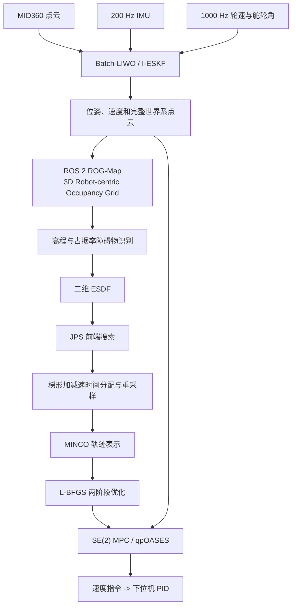
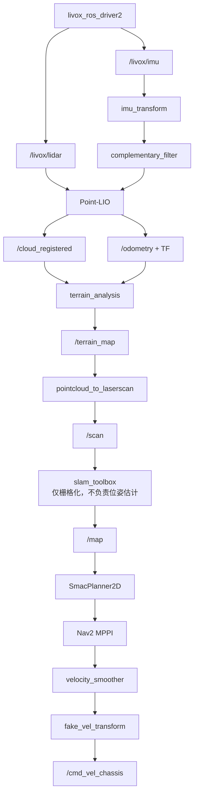

# 中科大哨兵 2025 技术报告导航部分与参考工程实现对比分析

> 分析对象：`UTF-8__中科大哨兵2025技术报告.pdf` 第 5 章“导航算法”  
> 参考工程：`/home/eatwhat/Nav2_rea_ws`（全程只读）  
> 当前重点启动文件：`src/bringup/launch/mapping_navigation_single_lidar.launch.py`  
> 分析方式：PDF 第 7-25 页逐页核对、参考工程源码/launch/参数静态审查  
> 注意：报告中的性能数据是报告作者给出的测试结果；本文未在实车上复现实测。

---

## 1. 总体结论

PDF 与参考工程在功能分层上相似，都遵循下列机器人导航流水线：

```text
激光雷达/IMU -> 激光惯性里程计 -> 障碍物表达 -> 路径/轨迹规划 -> 轨迹跟踪 -> 底盘控制
```

但二者的核心算法并不相同。参考工程不是 PDF 中导航系统的完整复现，主要关系如下：

1. 参考工程中的 Point-LIO 是 PDF 中 Batch-LIWO 的技术基础，但缺少 Batch 更新、轮速融合、残差置信度和完整点云恢复输出。
2. `dog_map` 在占据证据、射线清空和衰减机制上最接近 PDF 的 ROS 2 版 ROG-Map，但当前单雷达启动文件没有启动 `dog_map`。
3. 当前单雷达启动文件使用的是 `terrain_analysis -> pointcloud_to_laserscan -> slam_toolbox`，它与 PDF 的“ROG-Map -> 高程分析 -> 二维 ESDF”不是同一种感知/地图实现。
4. PDF 的 `JPS + ESDF + MINCO + L-BFGS` 规划器在参考工程源码中不存在，工程使用 Nav2 `SmacPlanner2D`。
5. PDF 的自研 `SE(2) MPC + Dense QP + qpOASES` 控制器在参考工程源码中不存在，工程使用 Nav2 MPPI。
6. 工程通过 `fake_vel_transform` 支持小陀螺坐标变换；PDF 则把小陀螺和狭窄区域底盘朝向切换纳入自研控制器。

因此，参考工程保留了报告方案的部分技术源头和比赛机器人接口思想，但最终运行架构已经转向标准 ROS 2/Nav2 组件组合。

---

## 2. 两套系统的总体链路

### 2.1 PDF 中的比赛导航链路



### 2.2 当前单雷达启动文件的实际链路



### 2.3 旧版 `bringup.launch.py` 链路

旧版链路和 PDF 的感知结构更接近：

```text
外部已启动的雷达驱动
  -> IMU预处理
  -> Point-LIO
  -> /cloud_registered
  -> dog_map
  -> /rog_map/inf_occ
  -> Nav2 STVL
  -> SmacPlanner2D
  -> MPPI
  -> fake_vel_transform
```

但该 launch 中雷达驱动、点云融合、`alignment` 和 `terrain_analysis` 都被注释，需要由其他启动过程补齐。

---

## 3. 模块对应关系

| 技术环节 | PDF 实现 | 参考工程实现 | 判断 |
|---|---|---|---|
| 雷达驱动 | 修改后的 Livox/RoboSense 驱动、共享内存传输 | `livox_ros_driver2` ROS 2 话题通信 | 使用同类硬件，传输优化不同 |
| 激光惯性里程计 | Batch-LIWO | Point-LIO | 同源但不是同版本 |
| 轮速融合 | I-ESKF 内融合轮速和舵轮角 | 未发现轮速订阅/滤波残差 | 缺失 |
| 全局定位 | PCD 预加载至 iVox，写入 xyz+yaw | `prior_pcd` 默认关闭；另有未启用 `alignment` | 部分具备 |
| 三维占据地图 | ROS 2 ROG-Map 机器人中心滑窗 | 当前为 `terrain_analysis`；旧链路为 `dog_map` | 当前差异大，旧链路较相似 |
| 射线清空 | 端点占据、激光射线沿途空闲 | `dog_map` 有，当前 terrain 链路没有同等实现 | 旧链路具备 |
| 障碍衰减 | 时间戳地图 Fading | `dog_map::TimeGoON()`；STVL也配置了衰减 | 思路相似 |
| 动态障碍物 | 时间/位置聚类和卡尔曼速度估计，未上场 | 未发现同等实现 | 缺失 |
| 距离场 | 二维 ESDF | Nav2 Costmap + Inflation | 数据结构和用途不同 |
| 前端搜索 | JPS | SmacPlanner2D | 功能相同，算法不同 |
| 连续轨迹 | MINCO | Nav2 Path/MPPI 离散预测轨迹 | 不等价 |
| 优化器 | L-BFGS，两阶段优化 | MPPI 随机采样加权 | 不等价 |
| 重规划 | 完全、部分、仅优化三种策略 | Nav2 行为树周期重规划 | 功能相似，连续性保证不同 |
| 控制器 | SE(2) MPC、稠密 QP、qpOASES | Nav2 MPPI | 都有预测思想，数学实现不同 |
| 延迟补偿 | 里程计、IMU、轮速同步前推，两次QP，10ms前瞻 | 20Hz开环速度平滑，无同等状态同步 | 差异大 |
| 小陀螺 | 根据 ESDF 狭窄度自动切换朝向 | `fake_vel_transform` 固定转速和坐标变换 | 目标相似，策略不同 |

---

## 4. 里程计：Batch-LIWO 与 Point-LIO

### 4.1 相同技术基础

两者都以 Point-LIO/I-ESKF 为基础，具有以下共同点：

- 使用 MID360 点云和 IMU。
- 使用点级时间戳处理非重复扫描点云。
- 采用增量体素地图/iVox进行点面残差计算。
- 使用 IMU 做状态传播，并考虑陀螺仪、加速度计饱和。
- 面向高速旋转、撞击和狭窄区域等高动态场景。

参考工程主要配置文件：

`src/localization/point_lio/config/mid360.yaml`

当前关键配置：

```yaml
use_imu_as_input: false
prop_at_freq_of_imu: true
check_satu: true
point_filter_num: 8
filter_size_surf: 0.2
filter_size_map: 0.2

common:
  lid_topic: "livox/lidar"
  imu_topic: "imu/data"
  time_diff_lidar_to_imu: -0.200432

mapping:
  imu_en: true
  satu_acc: 4.0
  satu_gyro: 35.0
```

`use_imu_as_input: false` 不等于没有使用 IMU。当前配置仍订阅 `/imu/data`，并且 `mapping.imu_en: true`、`prop_at_freq_of_imu: true`；这个开关选择的是 Point-LIO 内部不同的状态输入/输出分支。

### 4.2 Batch 更新差异

原始 Point-LIO 按点更新：每个有效点分别计算残差并更新状态。PDF 中 Batch-LIWO 将约 1ms 内的点：

1. 统一变换到同一时间戳；
2. 分别计算残差和测量矩阵；
3. 拼接后执行一次滤波更新。

这样减少 Predict/Update 次数，也为批量并行计算创造条件。参考工程源码中未发现 Batch-LIWO 或同等批量更新实现，因此其里程计仍属于 Point-LIO 路线。

### 4.3 轮速融合差异

PDF 根据四轮轮速和舵轮角度最小二乘求解底盘速度，再将该速度投影回各轮，利用期望轮速与实际轮速的残差调整协方差：

- 轮速一致时，提高轮速观测置信度；
- 单轮失效、打滑或反馈异常时，降低整组轮速置信度；
- 在点云退化或 IMU 位移二次积分不可靠时，为滤波器提供高带宽速度观测。

参考工程 Point-LIO 源码中未检索到 wheel odometry、wheel speed、encoder 或舵轮角度订阅，也没有对应的 I-ESKF 残差，因此不具备报告中的 LIWO 能力。

### 4.4 完整点云输出差异

PDF 将降采样舍弃的点放入按时间排序的队列，在滤波状态更新后进行短时前向积分，再把这些点转换到世界坐标系，从而向 ROG-Map 输出完整高密度点云。

参考工程当前配置为：

```yaml
point_filter_num: 8
publish_odometry_without_downsample: false
scan_publish_en: true
scan_bodyframe_pub_en: false
```

它会发布 `/cloud_registered`，但没有发现 PDF 所述的“补回所有降采样舍弃点”的队列与前向积分机制。

### 4.5 报告性能数据

PDF 对 Batch-LIWO 给出的数据为：

- Intel NUC 1240P，单线程处理约 6 万点/秒（不含被降采样舍弃的点）；
- 资源占用约 30%-40%；
- 20小时连续测试无内存泄漏、负载和延迟增长；
- 14 rad/s 小陀螺与约 3m/s 冲撞场景稳定。

这些指标不能直接套用到参考工程 Point-LIO，需要用相同 rosbag、参数和硬件重新测试。

---

## 5. 全局定位

### 5.1 PDF 方法

PDF 没有使用独立全局重定位节点，而是在 Batch-LIWO 内部：

- 加载预建 PCD；
- 用 PCD 预构造 iVox；
- 直接写入初始位置 xyz 与 yaw；
- 依赖机器人每场放置在大致相同的初始区域。

报告给出的经验启动范围约为 20cm 位置误差和 30° yaw 误差。

### 5.2 参考工程能力

Point-LIO 配置中存在：

```yaml
prior_pcd:
  enable: false
  prior_pcd_map_path: ""
  init_pose: [0.0, 0.0, 0.0]
```

源码会将 PCD 加载进 iVox，但当前参数关闭该功能，而且 `init_pose` 代码只写入三个位置分量，没有看到 PDF 所述的 yaw 初始化。

工程还包含独立包：

`src/localization/alignment`

该包支持预建 PCD、多分辨率匹配、NDT/GICP、初始位置与四元数，并可发布 `map -> odom_init`。这与 PDF “不设置独立全局定位模块”的架构不同。

不过当前单雷达启动文件明确不启动 `alignment`，而是使用静态恒等变换：

```text
map -> odom_init = identity
```

所以当前模式实际是以 Point-LIO 启动点作为在线地图原点，而不是在比赛场地预建地图中进行全局定位。

---

## 6. 三维感知与障碍物地图

### 6.1 PDF 的 ROS 2 ROG-Map

PDF 采用机器人中心的三维滑动占据栅格，核心机制为：

- 贝叶斯/log-odds 占据证据累积；
- 激光端点增加占据概率；
- 雷达到端点之间的体素降低占据概率；
- 机器人中心负责地图滑动，雷达位置负责 Raycasting 起点；
- TBB 并行 Raycasting；
- 独立时间戳地图完成 Fading；
- 输出规则化占据体素，而不是直接输出原始点。

报告给出的两组性能描述为：

- 2.5cm分辨率、10m x 10m x 1m、约8万点/秒时，50Hz帧周期内约6ms；
- 0.1m分辨率、10m x 10m x 0.8m时，4线程约2ms。

### 6.2 当前 `terrain_analysis`

当前启动文件真正执行的是：

`src/navigation/terrain_analysis/src/terrain_analysis_plus.cpp`

注意 CMake 中可执行程序虽然叫 `terrainAnalysis`，实际编译源文件就是 `terrain_analysis_plus.cpp`。

它订阅 `/cloud_registered` 与 `/odometry`，发布 `/terrain_map`，主要流程是：

1. 输入点云做0.05m体素滤波；
2. 按0.5m地形体素存储点；
3. 按0.1m平面体素统计高程；
4. 使用相邻列点高的25%分位数估计地面；
5. 点高于地面0.05m且低于车高1.5m时作为障碍候选；
6. 累积最近若干帧障碍点并发布。

这属于“点云积累 + 局部地面高程分析”，而不是概率占据地图。它没有完整实现：

- 端点占据、射线沿途空闲；
- log-odds贝叶斯更新；
- 真正三维循环滑窗；
- TBB并行Raycasting；
- 结构化占据概率输出。

### 6.3 `terrain_analysis` 中的疑似代码缺陷

在体素更新分支中，源码先执行：

```cpp
terrainVoxelCloudPtr->clear();
int laserCloudDwzSize = terrainVoxelCloudPtr->points.size();
```

清空后 `size()` 必然为0，因此后续原计划执行的衰减、距离筛选和重新插入循环不会处理旧点。其可能后果是：

- 到达更新点数或更新时间阈值时，体素被直接清空；
- 障碍点出现周期性消失；
- `decayTime` 实际行为与参数语义不一致。

该结论来自源码控制流静态分析，建议结合 `/terrain_map` 点数时间序列或 rosbag 进一步验证。

### 6.4 旧版 `dog_map`

`dog_map` 是工程中与 PDF ROG-Map 最接近的实现：

- 命中点增加占据证据；
- 射线路径降低占据证据；
- `TimeGoON()` 清除长期未观测障碍；
- 对Z方向占据范围和空洞进行障碍判断；
- 输出 `/rog_map/inf_occ` 给 Nav2 STVL。

当前参数为：

```yaml
resolution_z: 0.01
half_map_size: 10.0
frame_save: 3
LOG_OCC_HIT_mid360: 34
LOG_OCC_FREE: -20
THR_OCC: 30
MIN_LOG: 5
```

主要差异是：

1. 底层数组尺寸和原点依赖预建 PGM，不是真正无限机器人中心滑窗；
2. TBB 编译宏当前被注释，实际是串行体素更新；
3. 高程分类没有完全实现 PDF 描述的柱体高度 H 与占据比例公式；
4. 没有动态障碍物聚类和卡尔曼速度估计。

### 6.5 动态障碍物

PDF 描述了按更新时间与空间位置聚类，再用恒速卡尔曼模型估计障碍速度的方案，但明确说明该部分没有上场、测试也不充分。

参考工程未发现等价动态障碍聚类和跟踪模块。STVL 的 `voxel_decay` 只能遗忘旧障碍，并不等同于估计障碍速度和未来位置。

---

## 7. 二维地图与 ESDF

### 7.1 PDF

PDF 将三维占据结果和可选先验二维地图转换为二维 ESDF。ESDF为每个位置提供到最近障碍物的欧氏距离和梯度，用于连续轨迹优化。

报告还说明：

- 计划研究静态与动态ESDF分离；
- FIESTA式增量更新在该赛季没有实装；
- 实际比赛版本采用动态重建二维ESDF，耗时约2ms；
- 通过二次函数插值缓解双线性插值在峡谷中心出现的梯度无效化。

### 7.2 参考工程

参考工程使用：

- `slam_toolbox` 输出二维 `OccupancyGrid /map`；
- Nav2局部/全局Costmap；
- STVL三维障碍层；
- Denoise层；
- Inflation膨胀层。

膨胀层能够表达靠近障碍物的高代价，但它不是连续ESDF，也不能向MINCO优化器提供PDF所需的连续距离梯度。

当前 `slam_toolbox_single_lidar.yaml` 还设置了：

```yaml
mode: mapping
transform_publish_period: 0.0
use_scan_matching: false
do_loop_closing: false
resolution: 0.05
```

因此它主要根据 Point-LIO 位姿把 `/scan` 栅格化到 `/map`，不承担第二套位姿估计和闭环校正。

---

## 8. 规划器：JPS/MINCO 与 SmacPlanner2D

### 8.1 PDF 规划流程


PDF 选择 MINCO 的重要原因是轨迹必然经过路标点，可以通过路标点和时间参数在模块间重建完全一致的连续轨迹。


*图 1：报告第16页，展示基于ESDF的MINCO/L-BFGS轨迹优化思路。*

### 8.2 两阶段优化

PDF 将优化分为：

- `PRE_OPTIMIZATION`：使用二次插值得到的完整梯度，配合段时间上下界，先获得稳定轨迹形状；
- `FINELY_OPTIMIZATION`：剔除沿轨迹速度方向的部分梯度，重点修正横向避障和动力学性能。

报告称该策略将约30m轨迹的单线程优化时间从约80ms降低到10ms以内，同时减少控制点数量并改善狭窄区域稳定性。

### 8.3 重规划

PDF 提供三种重规划模式：

1. 完全重规划；
2. 部分重规划；
3. 仅优化原轨迹。

部分重规划不是直接从机器人当前位置截断旧轨迹，而是从当前位置在旧轨迹上的投影点向前保留一小段旧轨迹，再拼接JPS结果，以降低新旧轨迹在当前位置处的位置、速度和加速度跳变。


*图 2：报告第18页，展示不同场景中的路径和优化轨迹以及重规划说明。*


*图 3：报告第19页，展示目标点修正、模式选择、完全/部分/仅优化和后端MINCO优化流程。*

### 8.4 参考工程规划器

参考工程配置：

```yaml
planner_server:
  ros__parameters:
    expected_planner_frequency: 5.0
    planner_plugins: ["GridBased"]
    GridBased:
      plugin: "nav2_smac_planner/SmacPlanner2D"
      allow_unknown: true
      max_planning_time: 2.0
      cost_travel_multiplier: 4.0
      smooth_path: true
```

SmacPlanner2D 在二维Costmap上进行代价感知网格搜索，并使用Nav2平滑器处理路径。与PDF相比：

- 不是JPS；
- 不使用ESDF；
- 不产生MINCO多项式轨迹；
- 不携带严格的轨迹时间、速度和加速度；
- 不使用L-BFGS；
- 没有PRE/FINELY两阶段优化；
- 没有保留旧MINCO轨迹段的连续重规划机制。

Nav2行为树可以周期性重新调用规划器，但只保证功能上的重新规划，不保证PDF所强调的高阶运动状态连续。

---

## 9. 控制器：SE(2) MPC 与 Nav2 MPPI

### 9.1 共同目标

二者都具有预测控制思想：

- 考察未来窗口内的机器人运动；
- 权衡轨迹跟踪、速度、控制平滑和避障；
- 支持全向移动底盘；
- 最终向底盘输出速度方向控制命令。

### 9.2 PDF 自研控制器

PDF 建立全向机器人的线性离散 SE(2) 模型，状态包含：

- 平面位置 x、y；
- yaw；
- x、y方向速度；
- yaw角速度。

控制量是平面控制力与yaw力矩。速度、控制输入和舵轮摩擦力约束被转换成统一线性不等式，最后形成稠密QP并由qpOASES求解。

报告给出的控制流程为：

1. 同步里程计、IMU和轮速；
2. 用高频IMU/轮速将延迟里程计积分到当前时刻；
3. 首次选择期望MINCO轨迹并求解QP；
4. 根据纵横向误差重新选择第二次期望轨迹；
5. 再次求解QP；
6. 输出预测起点后10ms处的速度，补偿计算、通信和下位机PID延迟。

数据频率为报告自述的100Hz Point-LIO、200Hz IMU和1000Hz轮速；40步QP平均约1ms。


*图 4：报告第23页，展示摩擦力/输入约束、稠密QP和定位同步设计。*

### 9.3 参考工程 MPPI

当前参数：

```yaml
controller_frequency: 50.0

FollowPath:
  plugin: "nav2_mppi_controller::MPPIController"
  time_steps: 80
  model_dt: 0.02
  batch_size: 1500
  iteration_count: 1
  motion_model: "Omni"
  vx_max: 5.0
  vy_max: 5.0
  wz_max: 1.5
```

80个时间步、每步0.02秒，对应1.6秒预测窗口；每轮生成1500组随机控制样本，再通过 Critic 对约束、障碍、路径、目标和姿态进行打分加权。

主要差异：

- MPPI是随机采样优化，不是稠密QP；
- 没有qpOASES；
- 没有显式的轮胎摩擦力约束矩阵；
- 没有控制器内部的200Hz IMU和1000Hz轮速状态前推；
- 没有PDF的两次参考轨迹选择和两次QP；
- 没有固定10ms控制命令前瞻。

后续 `velocity_smoother` 为：

```yaml
smoothing_frequency: 20.0
feedback: "OPEN_LOOP"
```

它只进行速度、加速度和超时限制，不等价于闭环状态估计或MPC时延补偿。

### 9.4 力控制与速度控制

PDF 的MPC数学模型优化控制力和力矩，但最终比赛实现没有把力控结果直接作为下位机前馈，而是选择预测轨迹中的速度发送给下位机PID。报告认为这会导致低速起步推力不足，并使用最低速度限制作为折中。

参考工程从MPPI开始就是速度指令链路：

```text
MPPI -> cmd_vel_nav -> velocity_smoother -> cmd_vel
     -> fake_vel_transform -> cmd_vel_chassis -> 下位机
```

所以两者最终都发送速度，但PDF内部保留了动力学力/力矩模型，参考工程MPPI主要工作在运动学速度采样层。

---

## 10. 小陀螺与底盘坐标

### 10.1 PDF

PDF 将底盘旋转分为：

- 空旷区域小陀螺前进；
- 进入狭窄区域前，底盘正面提前对齐轨迹切线；
- 狭窄区域内，在轨迹切向正反两个方向中选择转角较小的一侧。

环境狭窄程度由MINCO控制点在ESDF中的障碍距离判断，因此底盘朝向策略与规划器、地图紧密耦合。

### 10.2 参考工程

`src/navigation/fake_vel_transform/src/fake_vel_transform.cpp`：

- 订阅 `/odometry` 获取当前yaw；
- 发布 `base_frame -> base_frame_fake`；
- 把Nav2平移速度旋转到真实底盘坐标；
- 订阅 `/ai_tuoluo` 切换小陀螺；
- 发布 `/cmd_vel_chassis`。

当前单雷达启动文件设置：

```python
"spin_speed": 12.56
```

这是“固定小陀螺转速 + 坐标变换”，没有根据ESDF或狭窄程度自动选择底盘朝向。

### 10.3 横向方向反转代码

当前实际横向公式为：

```cpp
aft_tf_vel.linear.y =
    msg->linear.x * sin(angle_diff)
  - msg->linear.y * cos(angle_diff);
```

而同文件中被注释的标准二维旋转形式为：

```cpp
aft_tf_vel.linear.y =
   -msg->linear.x * sin(angle_diff)
   +msg->linear.y * cos(angle_diff);
```

二者整体相差一个负号。这是此前RViz导航横移方向与实车相反的直接可疑点。它不是MPPI的 `vy_max/vy_min` 参数造成的，而是导航速度到真实底盘速度转换时主动翻转了Y方向。

---

## 11. 当前单雷达链路的集成缺口

Nav2 的局部和全局 STVL 配置订阅：

```text
/rog_map/inf_occ       用于 marking
/cloud_registered_body 用于 clearing
```

但 `mapping_navigation_single_lidar.launch.py` 中：

- 没有启动 `dog_map`，所以该启动闭包中没有 `/rog_map/inf_occ` 发布者；
- Point-LIO 设置 `scan_bodyframe_pub_en: false`，通常没有 `/cloud_registered_body`；
- 实际启动的 `terrain_analysis` 发布 `/terrain_map`，只被送到 `pointcloud_to_laserscan` 和 `slam_toolbox`，没有直接进入STVL。

因此，若没有外部节点额外发布上述话题，则：

1. 全局Costmap可以通过StaticLayer获得slam_toolbox的在线 `/map`；
2. 局部STVL很可能收不到预期三维障碍物输入；
3. 局部动态避障能力可能弱于参数文件表面配置；
4. PDF中“ROG-Map占据体素直接服务ESDF规划”的闭环，在当前启动链路中并未形成。

建议实机启动后执行：

```bash
ros2 topic info /rog_map/inf_occ -v
ros2 topic info /cloud_registered_body -v
ros2 topic info /terrain_map -v
ros2 topic hz /terrain_map
ros2 topic hz /local_costmap/costmap
```

并在RViz中同时观察 `/terrain_map`、局部Costmap和全局 `/map`，确认障碍是否真正进入控制器使用的局部代价地图。

---

## 12. 差异总结与改造优先级

### 12.1 相似度总结

| 模块 | 相似度 | 说明 |
|---|---:|---|
| Point-LIO 与 Batch-LIWO | 中高 | 状态估计源头相同，但缺少Batch和轮速 |
| dog_map 与 ROG-Map | 中 | 有占据、射线和衰减，但滑窗、并行和障碍公式不同 |
| terrain_analysis 与 ROG-Map | 低 | 一个是高程点云过滤，一个是概率占据地图 |
| SmacPlanner2D 与 JPS/MINCO | 低 | 仅导航功能相同，轨迹表示完全不同 |
| MPPI 与自研SE(2) MPC | 中低 | 都预测未来，但求解器、状态和约束不同 |
| fake_vel_transform 与PDF底盘朝向策略 | 中低 | 都处理小陀螺，但工程没有环境自适应 |

### 12.2 若目标是提升现有工程，而非完整复刻PDF

建议顺序：

1. 先接通 `/terrain_map` 或 `dog_map` 到Nav2局部障碍层，确认局部避障数据链路真实有效；
2. 修正 `fake_vel_transform` 的Y方向符号，并统一底盘、雷达和Nav2坐标约定；
3. 修复/验证 `terrain_analysis` 清空后再取size的衰减逻辑；
4. 根据实测选择保留 `terrain_analysis` 还是切换到 `dog_map + STVL`；
5. 如需比赛场地全局坐标，再启用并完善 Point-LIO `prior_pcd` 或独立 `alignment`，不能同时让多个节点发布 `map -> odom_init`；
6. 最后再评估轮速融合、ESDF连续规划或自研MPC。这些属于架构级改造，不是简单参数调整。

### 12.3 若目标是接近PDF完整方案

需要新增或重构：

- Batch式点云滤波更新；
- 轮速/舵轮角I-ESKF观测模型及动态协方差；
- 完整稠密点云时间队列；
- 真正机器人中心的ROS 2 3D Occupancy Grid；
- 并行Raycasting和Fading；
- 二维ESDF及稳定梯度插值；
- JPS、时间分配、MINCO和L-BFGS两阶段优化；
- 连续轨迹重规划；
- 高频多传感器状态同步；
- SE(2)动力学MPC和qpOASES求解；
- 基于狭窄程度的小陀螺/底盘朝向切换。

这实际上是一套独立导航栈，工作量明显高于调整现有Nav2参数。

---

## 13. 关键文件索引

| 用途 | 参考工程文件 |
|---|---|
| 当前单雷达总启动 | `src/bringup/launch/mapping_navigation_single_lidar.launch.py` |
| 旧版总启动 | `src/bringup/launch/bringup.launch.py` |
| Nav2参数 | `src/bringup/config/nav2_params.yaml` |
| 单雷达slam_toolbox参数 | `src/bringup/config/slam_toolbox_single_lidar.yaml` |
| Point-LIO参数 | `src/localization/point_lio/config/mid360.yaml` |
| Point-LIO主逻辑 | `src/localization/point_lio/src/laserMapping.cpp` |
| Point-LIO参数读取 | `src/localization/point_lio/src/parameters.cpp` |
| 独立PCD对齐 | `src/localization/alignment` |
| 当前地形分析实现 | `src/navigation/terrain_analysis/src/terrain_analysis_plus.cpp` |
| 当前地形分析参数 | `src/navigation/terrain_analysis/config/terrain_analysis_plus.yaml` |
| dog_map占据地图 | `src/navigation/dog_map/src/occ_map.cpp` |
| dog_map节点 | `src/navigation/dog_map/src/node.cpp` |
| dog_map参数 | `src/bringup/config/dog_map.yaml` |
| 小陀螺速度变换 | `src/navigation/fake_vel_transform/src/fake_vel_transform.cpp` |

---

## 14. 分析边界

本文结论来自：

- PDF导航章节文字、公式、图表和作者自述性能；
- 参考工程源码、launch和YAML配置的静态检查；
- 对当前启动文件能够构成的节点/话题闭包分析。

本文没有进行：

- 实车导航运行；
- rosbag回放；
- CPU/延迟基准测试；
- TF运行时冲突检查；
- Nav2 Costmap话题运行时发布者检查。

因此，对“某个话题没有发布者”的判断是基于当前launch静态闭包；若实车还有独立启动的驱动、底盘或障碍节点，应以运行时 `ros2 topic info -v`、`ros2 node list` 和TF树为最终依据。
